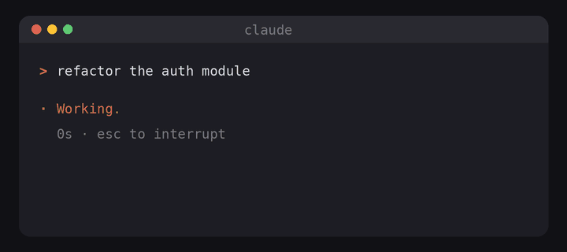

# 🔔 claude-ding

A tiny sound when Claude Code finishes a task, so you can stop staring at the terminal.



```bash
curl -fsSL https://raw.githubusercontent.com/nmamizerov/claude-ding/main/install.sh | bash
```

Move through the 5 sounds with ↑/↓ and each one plays right away. Press Enter on the one you like, set the volume with ←/→, then choose where to install it:

- **Global**: every project (`~/.claude/settings.json`)
- **This project**: only the current folder (`.claude/settings.local.json`, not committed)

By default it stays quiet while the Claude Code window is in front of you, so it only dings when you've switched away. It can also ding when Claude stops to wait for your permission or input.
Restart Claude Code afterwards. To change the sound, run the same command again.

## Sounds

| | name | meaning |
|---|---|---|
| 💸 | money | cash counter: money is charging |
| ⚔️ | battle | sword out of the sheath: ready to fight |
| 🎤 | mic-drop | mic drop: nothing more to say |
| 🚀 | ship-it | rocket launch: shipped |
| 🔔 | zen | singing bowl: calm, no rush |

Real recordings from [Freesound](https://freesound.org), all CC0 (public domain). Credits in [`sounds/CREDITS.md`](sounds/CREDITS.md).

## Skip the questions

```bash
curl -fsSL https://raw.githubusercontent.com/nmamizerov/claude-ding/main/install.sh | bash -s -- --sound money --scope global
```

| flag | |
|---|---|
| `--sound <1-5\|name>` | which sound |
| `--scope <global\|project>` | where to install |
| `--volume <1-100>` | loudness, default 40 |
| `--always` | ding even while you're looking at Claude Code |
| `--no-notify` | only ding when a task is done, not when Claude waits for you |
| `--uninstall` | remove the hooks (global + current project) and the files |

## How it works

It adds a [`Stop` hook](https://docs.claude.com/en/docs/claude-code/hooks) (and optionally a `Notification` hook) to your Claude Code settings:

```json
{
  "hooks": {
    "Stop": [
      { "hooks": [{ "type": "command", "command": "sh \"$HOME/.claude/claude-ding/play.sh\" 01-money 40 unfocused" }] }
    ]
  }
}
```

Sounds and `play.sh` live in `~/.claude/claude-ding/`. Your existing settings and hooks are kept as they are.

**"Not looking" detection.** On macOS it checks the frontmost app with `lsappinfo` (no permissions needed). If that app is the terminal or editor running Claude Code (Terminal, iTerm2, Ghostty, Warp, WezTerm, VS Code, Cursor, ...), it stays quiet. It works per app, not per tab: if Claude runs in one iTerm2 tab and you're reading another tab, it won't ding. On Linux/X11 it uses `xdotool` if installed. Anywhere else it just always plays.

Playback uses whatever the system has: `afplay` on macOS, `pw-play` / `paplay` / `aplay` on Linux, PowerShell on Windows (Git Bash or WSL). The sound plays in the background, so Claude is never slowed down.

## Uninstall

```bash
curl -fsSL https://raw.githubusercontent.com/nmamizerov/claude-ding/main/install.sh | bash -s -- --uninstall
```

## License

MIT
